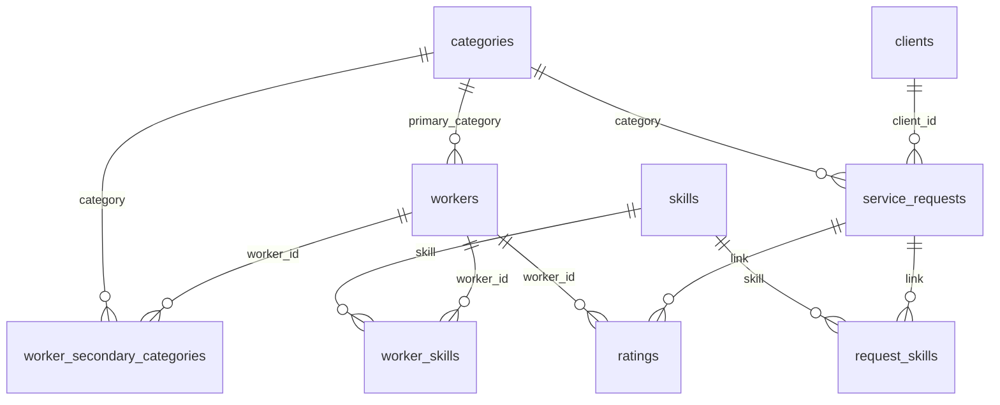

# Day 11 Report: PostgreSQL Persistence Integration

**Objective.** Add the PostgreSQL relational data layer that the project
architecture specifies, without changing any recommendation, the Neo4j
knowledge graph, or any experimental result. This is a read-only
integration: no CRUD, accounts or request creation.

## 1. Why PostgreSQL, and who owns what

| Store | Responsibility | Used by |
|---|---|---|
| **PostgreSQL** | Application data: clients, workers, service requests, skills and categories, training-period ratings | Request listing and lookup, worker profiles (Flask service layer) |
| **Neo4j** | The knowledge graph: skills, relatedness, specialisations, training interaction paths | The optional worker graph view; the source the KG snapshot was verified against |
| **Frozen artifacts** (`data/processed`, `results/`) | The deterministic inputs the models were evaluated on | The frozen CBF/CF/KG/hybrid models: candidate pools and scoring |

No graph traversal is duplicated in SQL, and **PostgreSQL never feeds the
models.** The recommender keeps reading the artifacts it was evaluated
on. The service links the two worlds by the existing identifiers (`link`,
`worker_id`).

## 2. Environment

- PostgreSQL **18.6** on Windows, port 5432. The role `hirewise_app` owns two databases:
  - `hirewise`, the application database;
  - `hirewise_test`, a disposable database used only by the opt-in destructive tests.
- Both databases use UTF-8 encoding (needed for the 144 non-ASCII titles). Their locale is `English_United States.1252`, which is why identifiers use the `"C"` collation (§4).
- **Driver stack:** SQLAlchemy **2.0.54** (Core only, no ORM) with psycopg **3.3.6** (binary). These are pinned in `requirements.txt` and are the only new dependencies.
- **Settings:** `POSTGRES_HOST`, `POSTGRES_PORT`, `POSTGRES_DB`, `POSTGRES_USER`, `POSTGRES_PASSWORD` and `POSTGRES_TEST_DB`, held in the git-ignored `.env`, the same convention as `NEO4J_*`. `.env.example` has placeholders only.

## 3. Schema



| Table | Primary key | Columns | Rows |
|---|---|---|---|
| `categories` | `name` | — | 88 |
| `skills` | `name` | — | 1,187 |
| `clients` | `client_id` | `country`, `preferred_pay_type`, `median_price_tier` | 2,000 |
| `workers` | `worker_id` | `primary_category` → categories, `experience_level`, `experience_years`, `price_tier`, `rate`, `country`, `join_day` | 3,000 |
| `worker_secondary_categories` | (`worker_id`, `category`) | both FKs | 3,031 |
| `worker_skills` | (`worker_id`, `skill`) | both FKs | 23,131 |
| `service_requests` | `link` | `client_id` → clients, `title`, `title_search`, `category` → categories, `pay_type`, `price_tier`, `budget`, `hourly_low`, `hourly_high`, `location_requirement`, `simulated_day`, `split` | 12,000 |
| `request_skills` | (`link`, `skill`) | both FKs | 56,277 |
| `ratings` | (`link`, `worker_id`) | `rating`, `has_review` (FKs to service_requests and workers) | 6,454 |
| `load_metadata` | `key` | `value`: schema version, content fingerprint, per-table row counts, SHA-256 of each source file | 18 |

- **Existing identifiers are the primary keys.** No surrogate IDs were invented.
- **Skills and categories are normalised** through mapping tables, rather than pipe-joined strings.
- **`title_search`** is the title lowercased by the loader in Python, so title search behaves exactly as it did on Day 10 regardless of the server's locale.

## 4. Constraints and indexes

**Primary keys:** every table.

**Foreign keys:** 11, all verified to have no orphans.

**NOT NULL:** all identifiers, categories, titles, simulated days, and every worker profile field. Nullable columns follow the data: client `median_price_tier` (13 nulls), request `price_tier`, raw pay fields, and `location_requirement`.

**CHECK constraints:**
- the `rating` value is between 1 and 5;
- `split` ∈ {train, validation, test};
- `pay_type` / `preferred_pay_type` ∈ {fixed, hourly, unspecified};
- `experience_level` ∈ {entry, intermediate, expert};
- `price_tier` columns lie in [0, 1];
- `rate` > 0, `experience_years` ≥ 0, `budget` > 0.

**Collation.** Identifier columns use **`COLLATE "C"`**, so ordering and uniqueness are by codepoint. That is exactly the order Python uses, so the listing order is identical to Day 10 regardless of server locale.

**Indexes,** each tied to a query in `src/db/repositories.py`:

| Index | Serves |
|---|---|
| `service_requests (split, simulated_day, link)` | Listing filter and its fixed order |
| `service_requests (category)` | Category filter |
| `service_requests (client_id)` | Client foreign-key lookups |
| `request_skills (lower(skill))` | Case-insensitive skill filter |
| `worker_skills (skill)` | Skill foreign-key lookups |
| `ratings (worker_id)` | Per-worker review aggregates |

## 5. Source → table mapping and privacy review

| Table | Source (model-visible only) |
|---|---|
| categories | `data/processed/category_stats.csv` |
| skills | `data/processed/skills_vocab.csv` |
| clients | `synthetic/clients.csv`: `client_id`, `country`, `preferred_pay_type`, `median_price_tier` |
| workers, worker_secondary_categories, worker_skills | `synthetic/workers.csv` |
| service_requests, request_skills | `synthetic/requests.csv` joined with `data/processed/sampled_requests.csv` |
| ratings | `synthetic/ratings.csv`, filtered to training-period requests |

**Deliberately not stored** (each decision approved in the Phase A review):
- everything in `synthetic_private/` and every generator-private variable;
- the client generator-scheduling fields `primary_category`, `activity_quota`, `activity_start_day` and `n_requests_assigned`;
- `is_cold_start` (the experiment cohort);
- `interactions` (shortlists and hires are evaluation outcomes, and the running app doesn't need them);
- validation- and test-period ratings, which are outcomes the app must not hold;
- review text, because none exists in the data.

**Kept, with a reason:**
- `split` on `service_requests`. Only validation/test requests are recommendable, and the API already exposed it. It is never used to reveal outcomes.
- The raw pay values `budget`, `hourly_low` and `hourly_high`, which the design document assigns to PostgreSQL for display. They are not exposed by the API yet.

The serializers' allow-lists are unchanged, so none of the database-only columns (`title_search` and the raw pay values) reaches a response.

## 6. Loading process

```bash
python scripts/init_postgres.py      # create missing tables/indexes; never drops or alters
python scripts/load_postgres.py      # load; no-op if identical; refuses if different
python scripts/load_postgres.py --reset   # EXPLICIT: truncate data tables, then reload
python scripts/verify_postgres.py
```

`src/db/loader.py` works as follows:
- `build_tables()` is pure Python. It reads only the model-visible files, sorts every table by primary key, and maps NaN to NULL.
- `fingerprint()` hashes a canonical serialisation of all rows.
- `load()` runs in **one transaction**:
  - an empty database is loaded in full;
  - if the database already holds the source's fingerprint, row counts and **read-back contents**, nothing changes;
  - if the contents differ, the load is **refused** unless `--reset` is given, in which case the data tables are truncated (never dropped) and reloaded.
- There are no timestamps or generated IDs, so loading the same artifacts into an empty database always produces identical contents.

**A bug the live tests caught.** The first version decided "unchanged" from the stored fingerprint and row counts only, so a row edited in place was reported as unchanged. The loader now fingerprints the actual read-back contents first (commit `17bbbc5`).

**Results:**
- The first load took 17.4 s. A repeat run reports `unchanged`.
- **The read-back database fingerprint equals the source fingerprint** (`48868ddc…9d95443`), table by table, including floats, Unicode titles and NULLs.

## 7. Flask integration

```
routes (thin, validated)  →  RecommendationService  →  PostgresRepository  →  PostgreSQL
                                     │
                                     └→ frozen models + EligibilityIndex (artifact rows)  →  ranking
```

- **`src/db/repositories.py`:** `PostgresRepository` uses only SQLAlchemy Core expressions with bound parameters. A static test confirms it builds no `text(...)` SQL. It returns rows in the shape the Day 9 serializers already consume.
- **The service** (`src/app/services.py`) gets request lookup and listing and worker profiles from the repository. Candidate pools and scoring still use the frozen artifact rows. Routes never touch the repository directly (tested).
- **`InMemoryRepository`** has the same interface and is built from the same `build_tables()` rows. It is used only by tests and as the parity reference; the application never falls back to it.
- **If PostgreSQL is down:**
  - the app still starts, because the engine connects lazily and the recommender loads independently;
  - data routes return **503 `database_unavailable`**, with no driver text;
  - `/api/health` returns 503 with `status: "unavailable"` and `postgresql: {available: false, …}`;
  - the frontend header shows "Application data is temporarily unavailable.";
  - there is **no silent CSV fallback**.
- **Health** now reports four things separately:
  - the application (it answers);
  - `recommender.ready`;
  - `postgresql` (`available`, `data_loaded`, `checked`);
  - `neo4j`.

  Neo4j being down still only degrades the optional graph view. Health never exposes hosts, ports, database names, users or SQL errors (tested).
- **Frontend:** one extra health message and one friendly error message. Nothing else changed.

## 8. Recommendation and API parity

| Check | Result |
|---|---|
| Before any code change, 3,304 Day 10 responses were captured at `d3b53fa` (all 72 listing pages, 9 filter queries including a Cyrillic title search, sample lookups, all 3,000 worker profiles, 112 recommendation responses, plus the 409 and 404 cases) and replayed against the PostgreSQL-backed service | **3,304 / 3,304 byte-identical** |
| The same replay against the artifact-backed reference repository | **3,304 / 3,304 byte-identical** |
| `verify_day11`: PostgreSQL app vs reference app across all 72 pages, filters, lookups, all 3,000 workers and 60 recommendation responses | byte-identical |
| `verify_day11`: recommendations vs the direct frozen Day 8 hybrid (ranking, scores, CBF/CF/KG contributions, explanation text, KG evidence, pool size) | equal |

Candidate sets, rankings, scores, contributions and evidence are unchanged.

## 9. Tests and verifiers

- **Default suite:** 480 tests, 469 pass, all without a database. 11 are skipped: 6 opt-in PostgreSQL tests, 2 opt-in Neo4j write tests, and 3 Neo4j read-only tests that skip because Neo4j was not running at the time.
  - `tests/test_db_schema_loader.py`: the exact column allow-list; no private or outcome columns; keys, foreign keys, CHECKs, collation and indexes; PostgreSQL DDL compiles; exact row counts; deterministic fingerprint; primary-key order; training-only ratings equal to the KG snapshot; referential integrity; only allow-listed source files read.
  - `tests/test_day11_app.py`: no SQL text in repositories, routes or services; an unreachable database yields `DatabaseUnavailable` without leaking credentials; 503 `database_unavailable` on every data route; health reporting; reference-repository semantics.
  - The Day 9/10 integration tests now inject the in-memory repository, so they stay database-free.
- **Opt-in live tests** (`HIREWISE_RUN_POSTGRES_TESTS=1`), 6 tests, all pass:
  - read-only checks on the main database: tables; contents equal to the source by fingerprint; constraints present; an invalid rating rejected inside a rolled-back transaction; live repository equal to the reference for lookups, workers and filtered listings;
  - a **destructive** create → load → idempotent re-run → drift refused → `--reset` restores the exact fingerprint → drop cycle, run **only** on `hirewise_test` and guarded against the main database name.
- **`scripts/verify_postgres.py`:** all 32 checks pass. It derives its expectations independently of the loader, from the CSVs directly, and covers counts, 11 foreign keys with no orphans, primary keys, forbidden columns, training-only ratings, sample rows against the CSVs, and source-file hashes.
- **`scripts/verify_day11.py`:** all checks pass, including running `verify_postgres` and `verify_day10` (which runs `verify_day9`). The live Neo4j count check was skipped because Neo4j was not running.

## 10. Security and configuration

- All queries are parameterised. Client input is never interpolated into SQL, and routes keep their Day 9/10 validation.
- Engines use `hide_parameters=True`. SQLAlchemy masks the password in URL output, and scripts print only the exception *type* on failure.
- The app connects as the non-superuser role `hirewise_app`, which owns only the HireWise databases.
- `.env` stays git-ignored. No passwords, data directory or database dump were committed.

## 11. Performance (local, indicative)

Measured through the Flask test client against the local PostgreSQL 18:

| Measure | Value |
|---|---|
| Schema creation | under 1 s |
| Initial load | 17.4 s |
| Idempotent re-run (`unchanged`, full content check) | 2.4 s |
| `create_app` (models; database engine is lazy) | 2.2 s |
| Listing page | median 21 ms |
| Listing with skill filter | median 25 ms |
| Listing with title filter | median 30 ms |
| Request lookup | median 4.7 ms |
| Worker lookup | median 7.2 ms |
| Recommendations | median 65 ms, mean 100 ms (Day 10, in memory: median 29 ms) |

The increase comes from the database round-trips that replaced in-memory dictionaries. It is acceptable for a development prototype; this is not a production-scale claim.

## 12. Limitations

1. **The database is read-only from the application.** There is no account, request, rating or hiring write path; those are out of Day 11 scope.
2. **The frozen artifacts and PostgreSQL must stay consistent.** The service raises `FrozenArtifactMismatch` if a request exists in PostgreSQL but not in the frozen artifacts, and `verify_day11` checks the fingerprint equality.
3. **There is no migration framework.** Schema version 1 is created from a single SQLAlchemy definition, and `init_postgres.py` only adds missing tables. A future schema change needs a versioned migration step.
4. **Recommendation latency roughly doubled** because of the extra database round-trips; it is still small.
5. **Neo4j was not running** during the final verifier runs. Its read-only checks skipped cleanly, and the app correctly reported `degraded`. Day 6–10 established Neo4j's read-only behaviour, and Day 11 changes nothing there.
