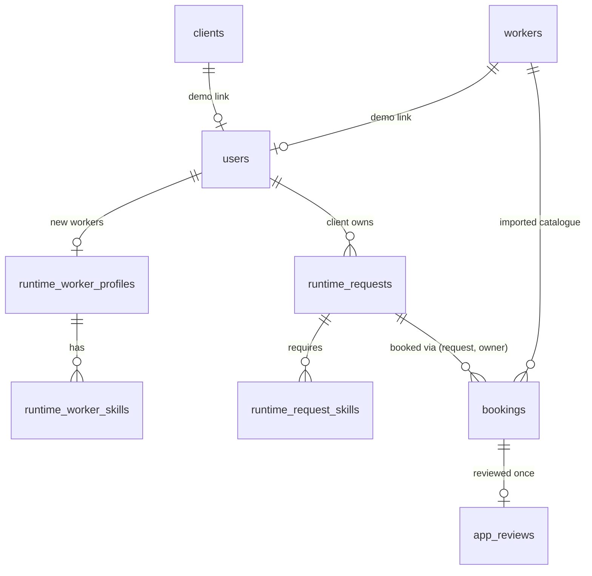

# Day 12 Report: Authentication and Standalone Marketplace Workflow

**Objective.** Turn HireWise into a small, complete marketplace around the
frozen recommender:

**register → login → create request → get recommendations → book a worker → worker accepts → client completes → rate and review**

The recommender models, weights, evaluation, prior results, generator
data, Neo4j graph and the imported PostgreSQL tables are unchanged.

## 1. Authentication

| Concern | Implementation |
|---|---|
| Passwords | Werkzeug `generate_password_hash` (scrypt) and `check_password_hash`. Only the salted hash is stored. Hashes are never logged, never returned (profile reads exclude them, so only the login path sees them), and never echoed into forms |
| Unknown-email timing | Login for an unknown email still checks the password against a dummy hash, and the error is the same generic "Invalid email or password." |
| Sessions | Flask's signed-cookie session holds only `user_id` and the CSRF token. It is cleared on login (prevents session fixation) and on logout. 8-hour lifetime, `HttpOnly`, `SameSite=Lax`, and `Secure` when `HIREWISE_SECURE_COOKIES=1` |
| Secret key | Comes only from `FLASK_SECRET_KEY` in `.env`, read when the app is created; never hard-coded or logged. **The production configuration (the default) refuses to start without it**: `create_app` raises `MissingSecretKey` with a clear message before any model or data loading. Development and testing may fall back to a temporary random key, logging a warning, so logins end on restart. Verifier and demo scripts are not deployments: they set a process-local random key only if none is configured |
| CSRF | A per-session random token (`secrets`) in every form, checked with `hmac.compare_digest` on every POST/PUT/PATCH/DELETE outside `/api` (all `/api` routes are read-only GETs). No extra dependency, since Flask-WTF was not needed |
| Login throttling | An in-process limiter: 5 failures per (address, email) in 15 minutes returns 429. It is per process and needs no infrastructure |
| Guards | `login_required` redirects to `/login?next=…`, and only local paths are followed after login. `role_required` returns 403 |
| HTTP methods | Every state change (register, login, logout, create, book, transition, review) is a POST. GET never changes state, so `GET /logout` and `GET …/book` return 405 |
| Output | Jinja autoescaping. No inline script or style, so the strict same-origin CSP still holds. Contribution bars use native `<meter>` elements. Errors outside `/api` render an HTML page; `/api` keeps its JSON error contract |

## 2. Roles and imported vs runtime profiles

Roles are **client** and **worker**, enforced by a CHECK constraint.

| Account | How it is created | Profile | Recommendable? |
|---|---|---|---|
| New client | `/register` | Display name, optional country | — |
| New worker | `/register` | Category, experience, rate, country and vocabulary skills, stored in `runtime_worker_profiles` | **No.** The frozen models only know the imported catalogue, so new profiles are not recommended until a future re-run of the pipeline. The dashboard says so |
| Demo client | `scripts/create_demo_account.py --client-id C…` | Linked to an imported client | Its research-period hiring history legitimately informs CF and KG |
| Demo worker | `scripts/create_demo_account.py --worker-id W…` | Linked to an imported worker | Yes (part of the catalogue), so it can accept bookings in a demo |

Public registration **never** links an account to an imported profile.
Linking is only possible through the explicit script. The script reads
the password from `HIREWISE_DEMO_PASSWORD` or a hidden prompt, and no demo
password appears in tracked source. Imported profiles and runtime users
are never merged; a link is a nullable unique foreign key on `users`.

## 3. Database additions (schema version 2)

All tables are additive: no imported table was altered, and
`init_postgres.py` only creates tables. The imported data fingerprint is
unchanged (`48868ddc…`).

| Table | Purpose | Key constraints |
|---|---|---|
| `users` | Accounts | Identity primary key; unique lowercased email (CHECK); role ∈ {client, worker}; optional unique `client_id` → clients and `worker_id` → workers, each allowed only for the matching role |
| `runtime_worker_profiles` | Profiles of newly registered workers | `primary_category` → categories; experience level/years and rate CHECKs |
| `runtime_worker_skills` | Their skills | → skills (controlled vocabulary) |
| `runtime_requests` | Client-created requests | Owner → users; category → categories; pay-type CHECKs (budget only for fixed, hourly fields only for hourly, low ≤ high, positive amounts); title length; `price_tier` in [0, 1] |
| `runtime_request_skills` | Their skills | → skills |
| `bookings` | Hiring | **Composite FK (request_id, client_user_id) → runtime_requests**, so a booking's client is always the request owner; `worker_id` → workers; status CHECK; `completed_at` set **iff** completed; **partial unique index: at most one live (pending, accepted or completed) booking per request** |
| `app_reviews` | New application reviews | Primary key = `booking_id` (one review per booking); rating CHECK 1–5; optional text ≤ 2,000 characters |

**Indexes:** bookings by worker and by client (the two dashboards), and runtime requests by client ("My requests").

**Loader change.** `load_postgres.py --reset` now deletes imported rows
row by row instead of truncating them. PostgreSQL then **refuses** the
reset while runtime data references imported rows, so a reset can never
orphan bookings or users.



## 4. Imported vs runtime data separation

| | Imported experimental data | Runtime application data |
|---|---|---|
| Tables | `categories`, `skills`, `clients`, `workers`, `worker_*`, `service_requests`, `request_skills`, `ratings` | `users`, `runtime_*`, `bookings`, `app_reviews` |
| Origin | Deterministic load from frozen artifacts (fingerprinted) | Live user actions |
| Written by | `load_postgres.py` only | The marketplace pages |
| Feeds the recommender? | Its source artifacts do | **Never.** Bookings and reviews do not reach the frozen models' history, the KG snapshot, or Neo4j |

Runtime reviews have optional text. The imported `ratings` table has
none, because no review text exists in the source data. They are
separate tables.

## 5. Runtime recommendation for new requests (methodology)

This was designed and documented before implementation;
`src/app/marketplace/runtime.py` is a path separate from the frozen evaluator.

The **full frozen Day 8 hybrid** (CBF 0.40 / CF 0.10 / KG 0.50, with
per-pool min-max normalisation) is applied to the new request's
observable features. Nothing is retrained and no frozen object is
modified.

1. **Feature mapping.**
   - The category and controlled-vocabulary skills come from the form.
   - `price_tier` uses the **exact Day 2 definition**: the pandas average-rank percentile of the pay amount within (category, pay type), over the frozen in-scope reference population. It was validated by leave-one-out to reproduce **3,000 / 3,000** sampled stored tiers exactly, and is re-checked independently in `verify_day12` with a pandas rank.
   - Unspecified pay gives no tier, so CBF's evaluated neutral price score applies.
2. **Timeline.** The request is placed at the end of the simulated timeline (the latest experimental request day, 364.99). Every catalogue worker has joined by then, and the frozen KG temporal guard holds: only training-period history is visible.
3. **CBF.** A *new* frozen-weight `ContentBasedRecommender` over the frozen worker profiles and this one request.
4. **KG.** A *new* `KnowledgeGraphRecommender` over the **frozen training-only `KGIndex`**, with the frozen selected configuration:
   - skill, related-skill, category and reputation paths need only observable features;
   - **history paths exist only if the client is linked to an imported client with real training hires.**
5. **CF.** A shallow, non-mutating view of the frozen CF model whose only difference is this request's link → client map.
   - **A client without imported history gets no CF evidence**, so the CF score is constant and contributes exactly 0 under the hybrid's existing constant-component rule.
   - **No history is fabricated.** The request page says so explicitly.
6. **Candidates.** The experimental eligibility function (category, join day, location) over the imported catalogue.

**Checks that this is safe:**
- Tests and the verifier confirm that after runtime use the frozen service's recommendations are unchanged, the frozen CF map is untouched, and the Day 8 manifest hashes still match.
- An independent recomputation in `verify_day12` reproduces the runtime ranking and scores.

## 6. Booking workflow

```
pending  --accept-->   accepted   (the booked worker, i.e. the account linked to that worker_id)
pending  --decline-->  declined   (the booked worker)
pending  --cancel-->   cancelled  (the owning client)
accepted --complete--> completed  (the owning client)
accepted --cancel-->   cancelled  (the owning client)
```

- `declined`, `cancelled` and `completed` are terminal.
- The transition table and actor checks are pure functions (`src/app/marketplace/rules.py`).
- The database update applies only from the expected prior status, so concurrent changes are caught.
- **A client may book only a worker in the request's current recommendation set**, enforced on the server: the deterministic Top-10 shown on the request page is recomputed when the booking is made. A worker who is eligible but not recommended is refused with 400. Bookings are only for the client's own request. A second live booking is refused, and rebooking becomes possible after a decline or cancellation.
- **Future work:** a separate marketplace search/browse workflow could let clients book workers who weren't recommended, as an explicit, distinct path, so the recommendation-driven flow stays unchanged.
- Acting on someone else's request or booking returns **404** (existence is not revealed). The wrong role gets 403, or an "action not available" message for wrong-state transitions.
- **No payment state.**

## 7. Reviews

- Only the **owning client** may review, only a **completed** booking, and only **once**: the primary key enforces this as well as the application check.
- The rating is 1–5. Optional text is limited to 2,000 characters and stored in `app_reviews`.
- Reviews appear on the worker's profile and in both dashboards' booking tables.
- They do not influence the frozen recommender.

## 8. Frontend

- **Public pages:**
  - `/`, the HireWise landing page;
  - `/register`, `/login`;
  - `/demo`, the **Research Demo**: the Day 10 browse-and-recommend page over the imported research requests, moved off the public landing page.
- **Signed-in pages:**
  - `/dashboard`, with a client or worker variant (signed-in users who open `/` are redirected here);
  - `/client/requests`, `/client/requests/new`;
  - `/client/requests/<id>` (**Recommended Workers**);
  - `/workers/<id>` (worker profile);
  - `/bookings` (**Service History**) and `/bookings/<id>/review` (profile + rating and review);
  - `/profile` (worker);
  - POST `/logout`.
- **Navigation** follows the authentication state, with no dead links:
  - logged out: How it works / For Clients / For Workers / About (anchors on the landing page), Log in, Sign up;
  - client: Dashboard / My Requests / Service History, plus an account menu with Log out;
  - worker: Dashboard / Service History / Profile, plus the account menu.

  The footer links to the Research Demo on every page.

### 8a. Wireframe alignment

The redesign follows the project wireframes (provided as reference
images), using plain CSS and Jinja with no framework.

**Implemented:**

| Wireframe | Implementation |
|---|---|
| Landing page | Header with logo, How it works / For Clients / For Workers / About, Log in / Sign up. Hero ("Skilled people. Meaningful work." / "Find the right people for your projects", Sign up + Log in) with the three floating labels; three feature cards (intelligent matching, transparent recommendations, secure bookings and reviews); "How HireWise works" in three steps |
| Account type selection | Two role cards, "I want to hire a worker" and "I want to offer services", with a radio button in each |
| Create client/worker account (step 1) | Stepper (Account details → Client/Worker details → Complete); email, password and confirm password; a side panel listing what the role can do |
| Tell us more about your client/worker account (step 2) | Client: your name, location (optional). Worker: your name, location, primary category, experience level, years of experience, rate, skills (comma separated). Each has a side panel |
| Recommended Workers | Title + request subtitle + "Back to Dashboard"; per worker: avatar, identity, rating summary, experience, location, skill chips, score pill, "Why this worker was recommended" panel, View profile, Book / Hire worker |
| Freelancer profile / review | Back link; left: profile header (avatar, identity, location, rating, years of experience), associated skills, services offered, HireWise reviews; right: "Submit Rating & Review" with a 1–5 star control (native radios, keyboard-accessible) and a review comment |
| Client and worker dashboards (described in the brief) | Welcome header, status summary tiles, active and recent requests, service history, top matches for the latest request (client); bookings, completed jobs, reviews received, profile and skills (worker) |

**Intentional differences:**
- **Scores are ranking scores, not percentages.** The wireframe shows "Matched Score: 94%". HireWise shows **"Hybrid score: 0.764"**: the frozen hybrid's min-max-normalised weighted sum within the request's eligible pool. That is not a probability, and the page says so.
- **No photos or personal names exist** in the data, so cards show an icon avatar and the worker's catalogue ID ("Worker W001674").
- **The explanation panel lists real knowledge-graph evidence** (the model's own path texts) rather than a composed prose sentence. The exact CBF/CF/KG contributions sit in a collapsible "Score breakdown".
- **The rating summary** uses the worker's research-period reviews (the data the KG reputation component uses). HireWise reviews are listed separately and labelled.
- **The review button reads "Submit review", not "Submit Review & Update Graph"**: reviews never write to the knowledge graph. The comment limit is the database's 2,000 characters (the wireframe shows 500).
- **"Services offered"** lists the worker's real primary and secondary categories.
- **Omitted rather than fabricated:**
  - the worker **bio**;
  - the client **default currency** and **preferred contact method**;
  - the "GBP" unit on the rate (the stored rate has no currency).
- **Registration steps.** The wireframe's "Complete" step is the welcome message on the new dashboard after the account is created. Experience level is collected alongside years, because the profile schema requires it.

**Registration behaviour:**
- **Choosing a role** shows only the shared fields (email, password, confirm, name) plus that role's fields.
- **Field names are role-specific:** `client_country` versus `worker_country`, `primary_category`, `experience_level`, `experience_years`, `rate` and `skills`.
- **With JavaScript** (`static/js/register.js`):
  - one step is shown at a time;
  - the other role's fieldset is *disabled*, so it is neither validated nor submitted;
  - its values are cleared when the role changes;
  - only the active role's fields become `required`.
- **Without JavaScript,** all steps show stacked, and modern browsers hide the other role's fields via CSS `:has()`.
- **The server enforces the selected role regardless.** A client submission carrying worker fields, or a worker submission carrying a client location, is rejected with a clear message and no account is created. `/register?role=client|worker` preselects the role (used by the landing page's "For clients" and "For workers" links).

**Accessibility and security are unchanged:**
- semantic headings, labelled fields, skip link and visible focus;
- measured contrast: text 15.6:1, muted text 7.0:1, primary buttons 5.7:1, placeholders 5.2:1, star graphics at least 3.5:1;
- the strict CSP still holds, with no inline script, style or event handlers. The new script is a same-origin file, and the icons are inline SVG with presentation attributes only.

## 9. Tests and verification

- **Default suite: 546 tests pass** (27 skipped: opt-in PostgreSQL and Neo4j-write tests). This includes `tests/test_day12_ui.py` for the redesign: landing page, role selector markup, script and CSS, server-side cross-role rejection, role-based landing after login, Recommended Workers sections (ranking scores, never percentages), the profile/review view, dashboards and security headers.
- **`tests/test_day12_marketplace.py`:**
  - pure tests for the state machine (every valid and invalid transition), actor checks and validation;
  - one behavioural suite covering registration and hashing, duplicates, invalid input, login/logout, generic errors, local-only `next`, rate limiting, session regeneration, role and ownership guards, request creation and price tier, runtime recommendations without fabricated history, the full booking → accept → complete → review flow, decline/cancel/rebook, ineligible and non-recommended workers, invalid and duplicate reviews, secret-key handling (production fails without a key; development and testing may use a temporary one), CSRF (missing, forged and foreign tokens), and Day 10/API regression.

    It runs on the **in-memory backend by default**, and on the **real `hirewise_test` PostgreSQL database** with `HIREWISE_RUN_POSTGRES_TESTS=1`: all 45 tests pass on each backend, plus direct database-constraint tests;
  - frozen-artifact and price-tier reproduction tests.
- **Live opt-in run:** the Day 11 and Day 12 PostgreSQL suites, plus the UI suite, 71 tests, all pass on `hirewise_test`.
- **`scripts/verify_day12.py`: 36 / 36 pass.**
  - It runs the full workflow over HTTP on `hirewise_test` only, re-derives the price tier and runtime ranking independently, and checks database constraints and Day 10 browsing.
  - The main database's imported data and runtime tables, and the Neo4j counts, are unchanged by the run.
  - It ends with **`verify_day11` passing**, which runs `verify_postgres`, `verify_day10` and `verify_day9`.

## 10. Demo flow (live presentation)

Setup, once:

```powershell
python scripts/init_postgres.py           # schema v2 (adds the marketplace tables)
python scripts/create_demo_account.py --show-demo-recommendation   # top worker for the demo request: W001674
python scripts/create_demo_account.py --role worker --email worker@demo.local --name "Demo Worker" --worker-id W001674
python -m flask --app "src.app:create_app('development')" run
```

Then, in the browser:
1. On the landing page, choose **Sign up**, then **I want to hire a worker**, and complete the steps (or log in).
2. Post a request: "Logo for a bakery"; Logo Design; skills "Logo Design, Adobe Illustrator"; fixed budget 150.
3. The Recommended Workers page appears, with W001674 ranked first (deterministic for a new client).
4. Press **Book / Hire worker** on W001674.
5. Log out, then log in as `worker@demo.local` and **Accept** the booking.
6. Log out, then log in as the client and **Complete** the booking.
7. Open **Service History** and choose **Rate & review**, then submit stars and a comment. The review appears on the worker's profile.

## 11. Performance (local, indicative)

Measured through the Flask test client on PostgreSQL 18 (n = 10):

| Action | Median |
|---|---|
| Register | 295 ms |
| Login | 262 ms |
| Create request | 28 ms |
| Request page with live Top-10 recommendations | 94 ms |
| Book | 11 ms |
| Dashboard | 11 ms |

Registration and login are dominated by the intentionally slow scrypt
password hash. Building the runtime recommender takes 0.4 s at start-up.

## 12. Limitations and future work

**Limitations:**
- New worker accounts are not recommendable, because the frozen catalogue doesn't include them.
- Runtime bookings and reviews do not update the models, the KG snapshot or Neo4j. That would require a documented re-run of the pipeline.
- Rate limiting is per process.
- There is no email verification or password reset.
- No CSRF protection is needed for `/api`, because it is read-only.

**Future commercial features** (documented, not implemented): marketplace search/browse with a separate booking path for workers who weren't recommended, payments and escrow, messaging, notifications, disputes, worker availability calendars, portfolios, marketplace search, admin and moderation, cloud deployment, fraud prevention, email verification and password reset, and synchronising runtime data into the knowledge graph under a versioned retraining protocol.
